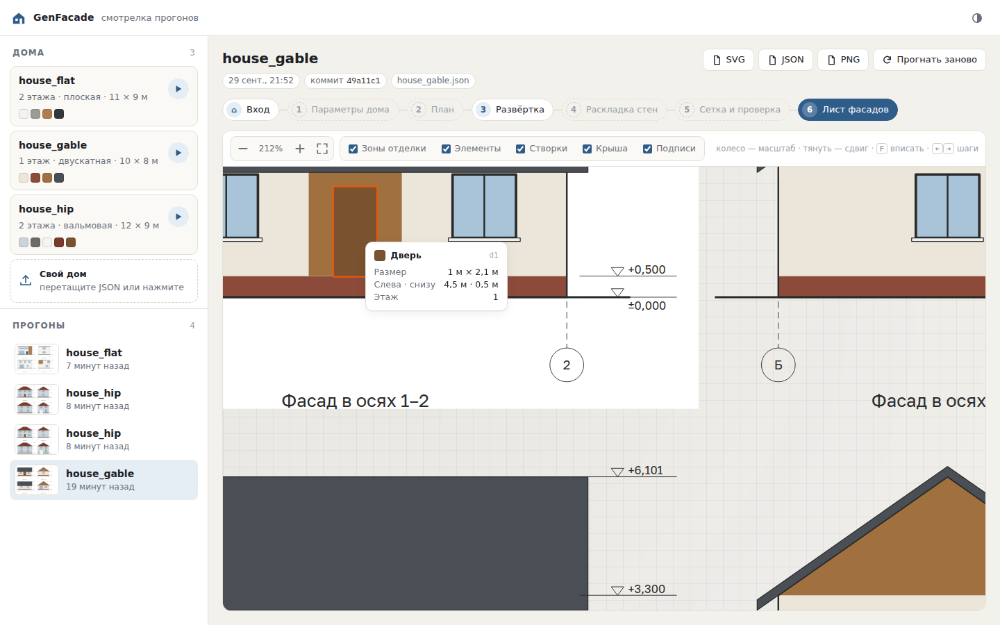

# GenFacade

Генерация векторных чертежей фасадов зданий по векторному плану и текстовому описанию.

Выпускная квалификационная работа, Университет ИТМО.
Тема: «Разработка метода генерации векторных чертежей фасадов зданий».

```
вход:   текстовое описание + векторный план дома (GenPlan — коттеджи; коллеги — МКД)
выход:  все фасады дома — цветной векторный чертёж (SVG + JSON)
режимы: 1 · глухой куб (окна ставит модель) · 2 · окна из плана (модель достраивает)
```

Схема модуля — [docs/assets/facade-modules.png](docs/assets/facade-modules.png),
требования — [openspec/](openspec/README.md).

В отличие от растровой генерации, результат должен оставаться **чертежом**:
сохранять геометрическую структуру, повторяемость элементов и выравнивание,
и допускать последующее редактирование в векторном редакторе или CAD.

## Установка

```
python3 -m venv .venv
.venv/bin/pip install -e ".[dev]"      # код, тесты, линтер
.venv/bin/pip install -e ".[dev,train]" # + torch, для обучения
.venv/bin/pip install -r tools/requirements.txt   # скрипты процесса: pyyaml, git-cliff
sh tools/install_hooks.sh                         # git-хуки и `git ticket <номер>`
python3 tools/secret_scan.py install              # gitleaks закреплённой версии для хука
sh tools/check.sh       # все проверки: ruff, pytest, спеки OpenSpec, сверка с источником,
                        # контекст, копипаста (нужен Node)

.venv/bin/genfacade run tests/fixtures/simple_house.svg \
    -t "A simple one-storey house" -m with_openings   # план + описание → фасады
.venv/bin/genfacade -c мои/ run tests/fixtures/simple_house.svg -t "…"  # со своими настройками
.venv/bin/genfacade serve                                            # смотрелка: http://127.0.0.1:8000
```

**Смотрелка** — на главной запуск «план + описание» (план из списка или свой SVG
GenPlan, режим) и история прогонов; прогон открывается на весь экран:
шаги 1–6 конвейера, чертёж (масштаб, слои — запретные зоны и нарушения на шагах 4–5,
карточка элемента при наведении), вход прогона с перезапуском. Esc или «назад» в браузере — на главную. Каждый прогон — папка
с трассой шагов в `outputs/runs/`.



Настройки по умолчанию — [genfacade/config/](genfacade/config/): библиотека материалов,
размеры и стиль листа. Своя папка с любыми из этих файлов переопределяет их.

## Статус

**Этап 1 закрыт 01.10.2026** ([план разработки](docs/dev-plan.md)):
сквозной конвейер — `genfacade run план.svg -t описание` проходит шаги 1–6
в обоих режимах — пока на одном простом доме 10 × 5 м с плоской крышей (gf#58): параметры
дома, препроцессор плана GenPlan, развёртка, раскладка стен, привязка к сетке и валидатор,
лист фасадов. Моделей пока нет: на шагах 1 и 4 — стабы с их интерфейсом
(`genfacade/models/`): фиксированный дом и заготовленные фасады.

Что уже сделано:

- этап 1: `genfacade run` — план GenPlan + описание по-английски → фасады всех сторон
  с трассой шагов 1–6; валидатор ловит окно плана, в которое упирается внутренняя стена
  (дефект GenPlan)
- этап 0: лист фасадов 1:100 в осях с отметками
  уровней (SVG + JSON + PNG), `genfacade serve` — смотрелка прогонов; настройки —
  в `genfacade/config/`
- постановка согласована с научруками и сведена в спеки; семь шагов конвейера,
  два режима, состав фасада по уровням (зоны отделки, палитра); схему и состав
  данных отправили научрукам 29.09 — Егор: суть верная, схему просил упростить
- разобраны код GenPlan (формат плана, генерация) и Facades-3D
- найдены данные: основной источник — 3D-модели BuildingNet v1 (~700–900 домов
  с планом и всеми фасадами), плюс синтетика своим генератором и ручная разметка
  реальных чертежей для теста
- разобран CMP Facade (51 769 прямоугольников, регулярность измерена);
  найден вырожденный оптимум единственной опубликованной метрики регулярности

## Документация

| Документ | Содержание |
|---|---|
| [openspec/](openspec/README.md) | **Требования: постановка, вход, представление, метод, данные, оценка, стыковка** |
| [docs/plan.md](docs/plan.md) | План работы для научруков — снимок 28.09 |
| [docs/statement.md](docs/statement.md) | Постановка до 28.09 — история; актуальное в openspec/ |
| [docs/datasets.md](docs/datasets.md) | Датасеты фасадов, разбор формата CMP |
| [docs/methods.md](docs/methods.md) | Подходы к генерации и векторизации |
| [docs/lab-repos.md](docs/lab-repos.md) | Что уже есть в CTLab-ITMO |
| [docs/papers.md](docs/papers.md) | Литература |
| [docs/metrics.md](docs/metrics.md) | Метрики и проверки корректности |
| [docs/decisions.md](docs/decisions.md) | Журнал решений |

Правила работы над проектом — [AGENTS.md](AGENTS.md) (для Claude Code ещё [CLAUDE.md](CLAUDE.md)),
почему они такие — [docs/WHY.md](docs/WHY.md). Исходная постановка от руководителя —
[docs/incoming/](docs/incoming/README.md). Порядок работы с требованиями —
[docs/shared/SDD.md](docs/shared/SDD.md), статус требований —
[таблица](docs/shared/product/Таблица%20требований.md).

## Как идёт работа

Процесс — из шаблона [agent-project-template](https://github.com/NikonFlex/agent-project-template)
(переведено 07.10.2026, gf#74; на процесс SDD — 13.10.2026, gf#116).

```
документ от научруков → docs/incoming/ (как есть) + строка в «Источники и старшинство»
  → требование в openspec/specs/ со строкой источника; сверка в обе стороны (source_check)
просьба хозяина → задача (docs/tasks/draft → backlog.py new) → ветка 12-имя + git ticket 12
  → код по спеке → коммит feat(<спека>): … → PR «Implements gf#12» → CI → GitHub сливает
находки по ходу → низ файла задачи; общее → docs/*.md; выбор → docs/decisions.md
урок → /journal → INSIGHTS.md (читается перед нетривиальной работой)
```

После клона — `sh tools/install_hooks.sh`: git-хуки `pre-commit` (ключи в индексе — gitleaks,
`tools/check.sh --quick`) и `commit-msg` (заголовок по Conventional Commits, номер задачи из
`git ticket`). Общие правила для Claude Code, Codex и Cursor — `AGENTS.md`, правила по темам —
`docs/agents/` (копии в `.claude/rules/`, `.cursor/rules/`), сторожа команд —
`.agents/guards/`. Навыки Claude Code — `/catchup`, `/task`, `/accept`, `/journal`,
`/contradictions`, `/fpsr`, `/inbox`, `/to-supervisors`. Состояние обвязки —
`python3 tools/harness.py`; выпуск версии — Actions → `release` (`cliff.toml`).

### Telegram: переписка во входящие

Переписка с научруками идёт в Telegram. Её пересылают пачкой в тему «Входящие» своей группы.
Бот забирает новое в буфер, это ветка `tg-inbox`: раз в час и по запросу `/inbox` (Action
[tg-pull](.github/workflows/tg-pull.yml), скрипт [tools/tg_inbox.py](tools/tg_inbox.py), gf#82).
`/inbox` в Claude Code собирает новое сейчас, выгружает его в `docs/incoming/`
([tools/tg_export.py](tools/tg_export.py)), разбирает по спекам и пишет итог в тему «Разбор» (gf#83).
Сообщение научрукам — `/to-supervisors`, только по просьбе: собираем вопросы, доделываем
вместе, в тему «Вопросы научрукам» оно уходит по «отправь».
События репозитория идут в тему «Задачи и PR»: новая и закрытая задача (с итогом «Что
установлено»), PR открыт и слит, красный CI на `main` (Action
[tg-notify](.github/workflows/tg-notify.yml), текст — [tools/tg_notify.py](tools/tg_notify.py),
gf#84).
Когда Claude закончил долгий ход (дольше `min_minutes` из [.claude/ping.json](.claude/ping.json))
или ждёт разрешения — пинг в тему «Claude» (хуки в `.claude/settings.json`,
[tools/tg_ping.py](tools/tg_ping.py), gf#92); номер темы — `TELEGRAM_THREAD_CLAUDE` в `.env`.

Настройка, один раз:

1. В @BotFather — `/newbot`, токен — в `.env` как `TELEGRAM_BOT_TOKEN`.
2. Группа только для себя и бота, с включёнными темами. Темы: Входящие, Разбор, Вопросы
   научрукам, Задачи и PR, Результаты. Бот — админ группы: иначе он видит только команды.
3. Написать что-нибудь в каждую тему и выполнить `python3 tools/tg_inbox.py discover`:
   он печатает id группы, номера тем и id отправителей. Записать их в `.env`:
   `TELEGRAM_CHAT_ID`, `TELEGRAM_OWNER_ID` (свой id) и
   `TELEGRAM_THREAD_{INBOX,ANALYSIS,QUESTIONS,TASKS,RESULTS,CLAUDE}`.
4. Проба: `python3 tools/tg_inbox.py send --topic inbox --file <текст>` — сообщение
   в теме; `--thread 999999` должен дать отказ 400.
5. Секреты репозитория (Settings → Secrets → Actions) с теми же именами: для сбора
   нужны `TELEGRAM_BOT_TOKEN`, `TELEGRAM_CHAT_ID`, `TELEGRAM_OWNER_ID`, `TELEGRAM_THREAD_INBOX`,
   для уведомлений ещё `TELEGRAM_THREAD_TASKS`.

## Связанные проекты лаборатории

- [GenPlan](https://github.com/CTLab-ITMO/GenPlan) — генерация векторных планов частных домов и 3D
- [Facades-3D](https://github.com/CTLab-ITMO/Facades-3D) — генерация 3D-зданий с экстерьером
- [VGLib](https://github.com/CTLab-ITMO/VGLib) — методы векторной графики, в том числе EvoVec
- [Text2SVG](https://github.com/CTLab-ITMO/Text2SVG) — генерация SVG по тексту

## Структура

Как устроен код и в каком порядке пишется — [docs/dev-plan.md](docs/dev-plan.md).

```
genfacade/ пакет фасадного модуля
openspec/  требования — единственный источник; карта источника, пути
docs/      база знаний, входящие, задачи, журнал, процесс (shared/), правила агентов (agents/)
tools/     процесс (бэклог, check.sh, приборы спек и контекста, хуки) и парсеры датасетов
tests/     тесты: unit/ по модулям, acceptance/ по требованиям спек; scenarios/ — раннер
materials/ чужие документы (вне git, опись в README)
data/      датасеты, не версионируется
```
